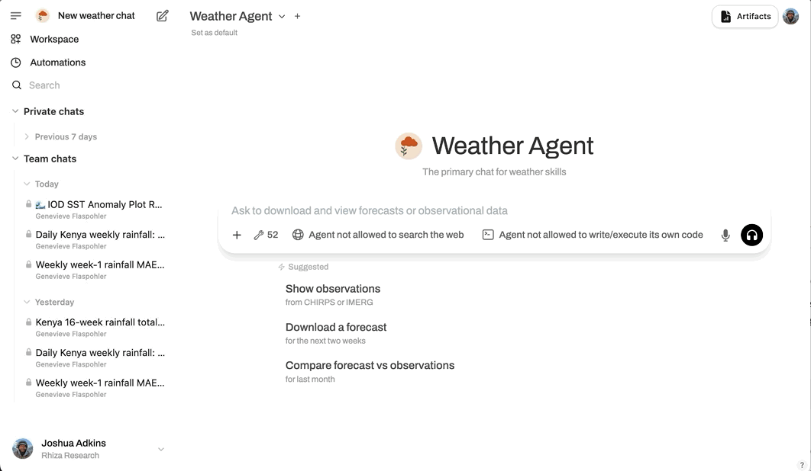

# Weather Skills Chat

Weather Skills Chat is a chat app for weather and climate analysis. In the product it is named **Weather Skills**. The model can run skills — small programs that fetch forecasts and observations, transform the data, and draw maps and charts — and each saved chat keeps the files those skills produce.

**Production:** [https://chat.weather-skills.org](https://chat.weather-skills.org)



The app is built on [Open WebUI 0.6.5](https://github.com/open-webui/open-webui/tree/v0.6.5). This repository is the Weather Skills fork. What the product adds or changes is documented in the [wiki](https://github.com/rhiza-research/weather-skills-chat/wiki). Upstream features the app still has are in the [0.6.5 documentation](https://github.com/open-webui/open-webui/tree/v0.6.5/docs).

## Features

- **Weather skills.** Installed skill packs give the model tools to fetch, clip, compare, and plot weather data. Output lands in that chat’s files (maps, charts, Zarr stores), which you can browse, preview, and download.
- **Chat files.** Every saved chat has its own artifact space. Temporary chats do not.
- **Organizations.** Teams share chats, skills, secrets, and saved instructions. Personal work stays in a personal organization. Admins set monthly spending limits.
- **Secrets.** API keys for weather services are stored encrypted and passed to skills as environment variables — they never appear in the chat.
- **Scheduled chats.** Automations resend a prompt on a schedule (for example a weekly rainfall summary).
- **Tool runner.** Skills can run in an isolated per-chat runner instead of on the chat server. When that path is on, the chat shows runner CPU and memory. See [Tool Runner](https://github.com/rhiza-research/weather-skills-chat/wiki/Tool-Runner).
- **Models.** Admins connect OpenAI-compatible providers (OpenRouter, and others) and, optionally, [Ollama](https://ollama.com).

Help: [help@weather-skills.org](mailto:help@weather-skills.org).

## Branches and releases

- Pull requests target **`dev`**. Pushes to `dev` build `ghcr.io/rhiza-research/weather-skills-chat` and deploy **staging**.
- **`main`** is the release line. A push to `main` builds an image and deploys nothing.
- A semver tag on `main` (`v1.2.3`) builds a release image and deploys **production**.
- The wiki is published from `dev`, so it describes staging.

Details are on [Deployment](https://github.com/rhiza-research/weather-skills-chat/wiki/Deployment).

## Run locally

You need Docker and a `.env` with at least `WEBUI_SECRET_KEY`. Copy [`.env.example`](.env.example) and fill in secrets. Isolation and HTTP/2 are flags, not `.env` values.

```bash
cp .env.example .env
# set WEBUI_SECRET_KEY (keep it stable or existing logins stop working)

./run-compose.sh --testing --isolation=off
```

- **`--testing`** starts Caddy so the browser uses HTTP/2 at [https://localhost:3443](https://localhost:3443). Without it, the app is on [http://localhost:3000](http://localhost:3000).
- **`--isolation=off`** runs skills on the chat server with no Landlock (the usual choice on a Mac).
- **`--isolation=landlock`** confines skills on the chat server (Linux with Landlock).
- **`--isolation=emulator`** uses the local tool-runner emulator (no cluster). The tool runner status appears in the top bar.
- **`--ollama`** also starts an Ollama container and connects the app to it.
- **`--build`** rebuilds the image from this checkout before starting.

Add a model in the admin settings, or set `OPENAI_API_BASE_URL` and `OPENAI_API_KEY` in `.env`.

To work on the UI and API without Docker, start `npm run dev` and `backend/dev.sh` as described on [Development](https://github.com/rhiza-research/weather-skills-chat/wiki/Development).

## Images

| Image | Role |
| --- | --- |
| `ghcr.io/rhiza-research/weather-skills-chat` | The chat app |

Tags follow the branch (`dev`, `main`), `latest` (from `main`), commit (`sha-…`), and release versions.

The tool runner image, `ghcr.io/rhiza-research/weather-skills-sandbox-runner`, is built in [rhiza-research/infrastructure](https://github.com/rhiza-research/infrastructure) (`images/sandbox-runner`).

Production and staging run on Kubernetes with [`charts/weather-skills-chat`](charts/weather-skills-chat).

## License

This project includes Open WebUI, licensed under the [BSD-3-Clause License](LICENSE).
